<div align="center">


# BootForge

### Turn an ISO into a bootable USB drive.

A bootable USB creator for Windows, written in **Rust**.
Pick an image, pick a drive, and BootForge tells you what the image is, which write mode suits it, and exactly what will be erased before anything is written.

<p>
  
  
  
  
</p>

<p>
  
  
  
  
  
  
</p>

[**Features**](#-features) ·
[**What boots**](#-which-images-work) ·
[**Screenshots**](#%EF%B8%8F-screenshots) ·
[**Download**](#-download) ·
[**Safety**](#%EF%B8%8F-safety) ·
[**Changelog**](CHANGELOG.md) ·
[**Developer**](#-developer)

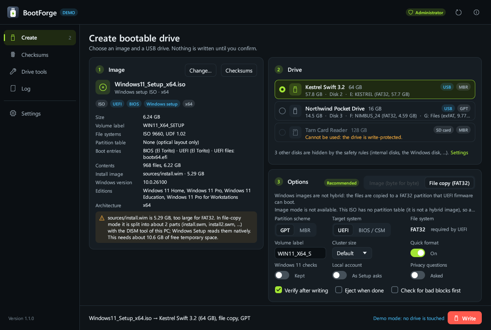

</div>

---

> [!WARNING]
> **Early release.** BootForge's writer, partitioner, FAT32 formatter and ISO extractor have been tested thoroughly against disk image files, but BootForge has **not yet been tested by writing a real USB drive or booting one on real hardware**. The Windows Setup options write a standard answer file that was checked as a file, not by running a Windows installation with it. Writing erases the chosen drive. Use it on a drive you can afford to wipe, and please report how it goes.

## ✨ Features

<table>
<tr>
<td width="50%" valign="top">

### 🔎 Understands the image
- ISO 9660, Joliet, Rock Ridge and UDF
- BIOS and UEFI boot entries, hybrid MBR/GPT detection
- Windows setup images: `install.wim` size, version and editions
- Architecture, volume label, file count
- Recommends the right write mode and explains why
- Remembers the images you used last

</td>
<td width="50%" valign="top">

### ✍️ Two write modes
- **Image mode:** byte-for-byte, for hybrid Linux ISOs and `.img` files
- **File copy mode:** GPT or MBR, FAT32, files extracted from the ISO, for UEFI boot
- Splits a Windows `install.wim` larger than 4 GB using the DISM tool already on your PC
- **Windows Setup options:** skip the TPM, Secure Boot and RAM checks of Windows 11, set up with a local account, skip the privacy questions
- Verify after writing; optional bad-block check first
- Keeps the PC awake while it works and flashes the taskbar when it is done

</td>
</tr>
<tr>
<td valign="top">

### 🧰 Drive tools
- Back up a USB drive to an image file, and restore it
- Reset a drive to a normal empty one (FAT32 or exFAT)
- Bad-block check that also detects fake-capacity drives
- Log pane with saved logs

</td>
<td valign="top">

### #️⃣ Checksums
- MD5, SHA-1 and SHA-256 of any image
- Paste the publisher's checksum to compare
- Finds the publisher's checksum file next to the image (`SHA256SUMS`, `image.iso.sha256`, …) and checks the image against it
- Also from the command line: `BootForge.exe --hash <file> [--expect <checksum>]`

</td>
</tr>
</table>

## 💿 Which images work

By design; none has been booted on real hardware yet.

| Image | Mode | Expected result |
|---|---|---|
| Hybrid Linux ISO (most modern distributions) | Image | Boots as its maker built it, BIOS and UEFI |
| Windows 10 / 11 setup ISO | File copy | UEFI boot |
| Linux ISO | File copy | UEFI boot, if the distribution tolerates a file copy |
| Raw `.img` disk image | Image | Written as is |
| Non-hybrid, BIOS-only ISO | none | Cannot be made bootable |

Not supported in this version: BIOS/CSM boot from copied files, NTFS targets, any single file over 4 GB other than a splittable `install.wim`, persistence, multi-boot, and compressed (`.gz`, `.xz`) images. See [`docs/HOW-IT-WORKS.md`](docs/HOW-IT-WORKS.md).

## 🖼️ Screenshots

<table>
<tr>
<td width="50%" align="center"><b>Linux image</b><br>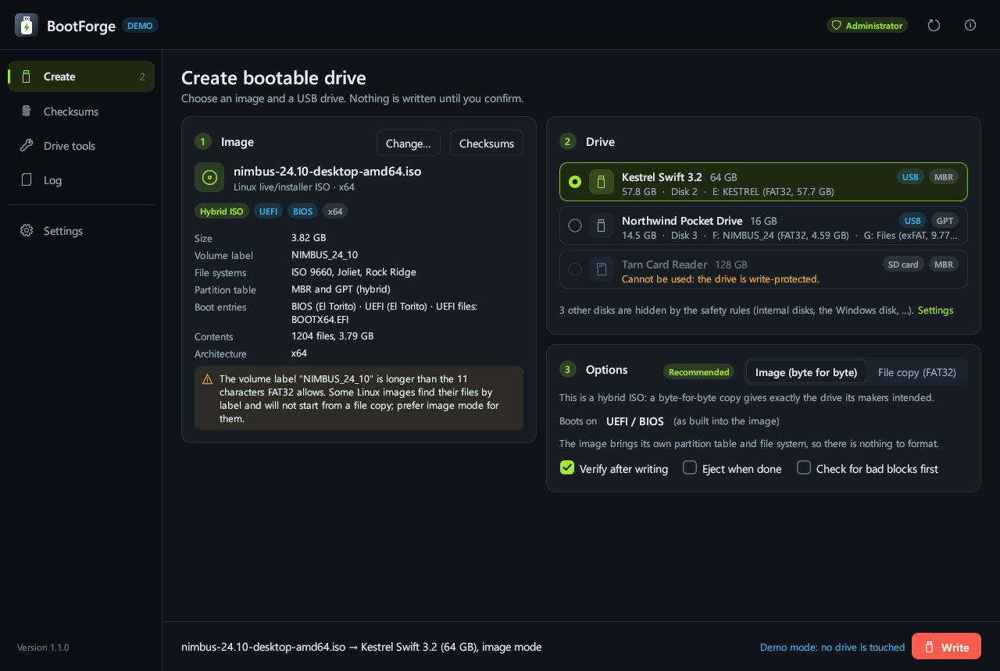</td>
<td width="50%" align="center"><b>Confirm what will be erased</b><br>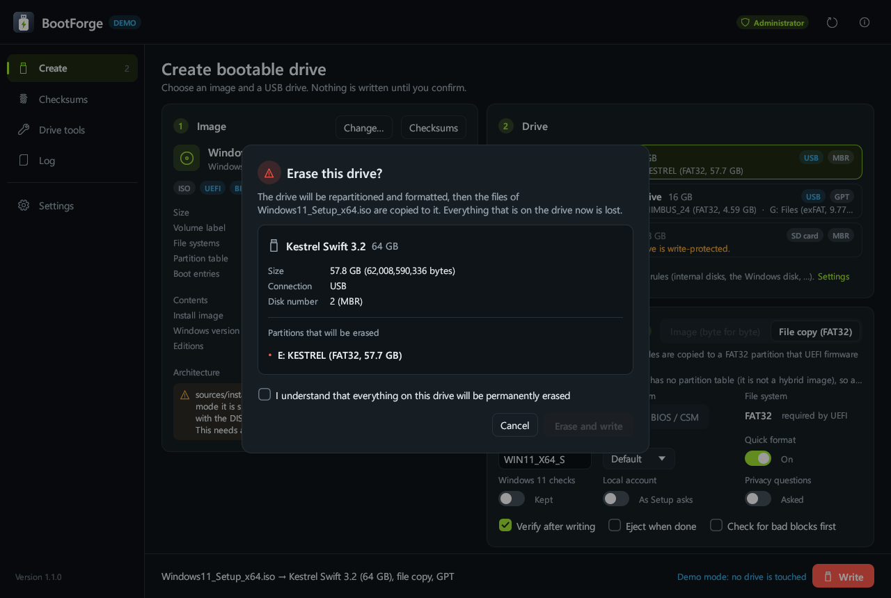</td>
</tr>
<tr>
<td width="50%" align="center"><b>Progress</b><br>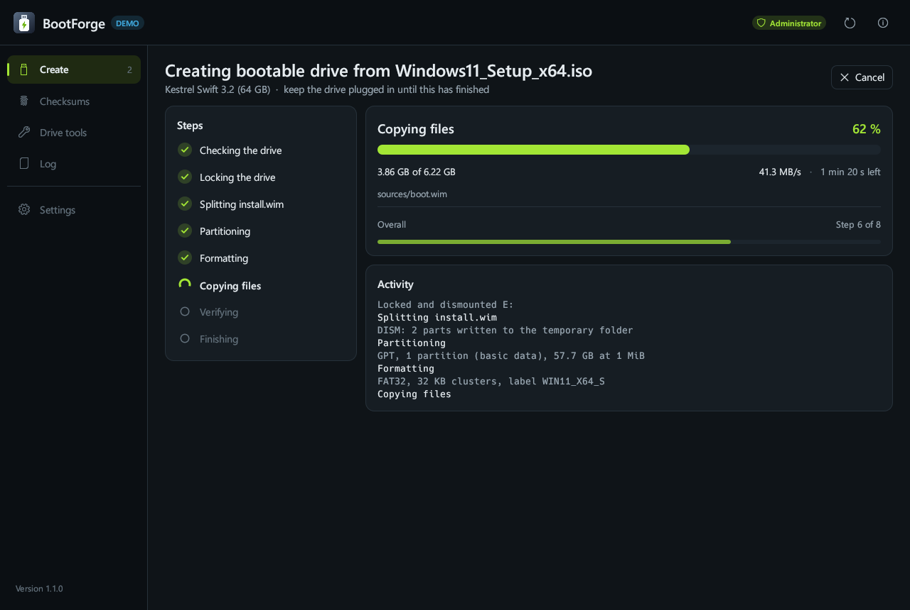</td>
<td width="50%" align="center"><b>Done</b><br>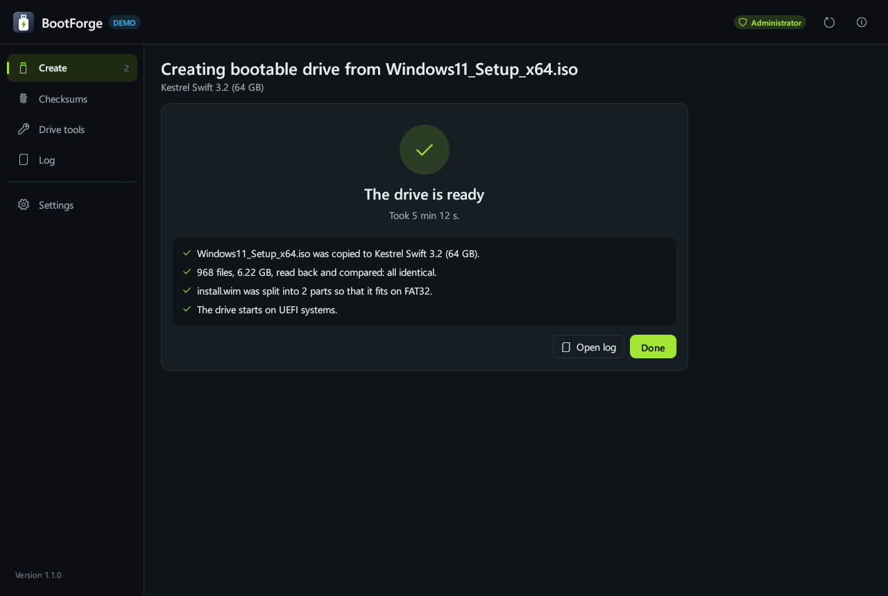</td>
</tr>
<tr>
<td width="50%" align="center"><b>Checksums</b><br>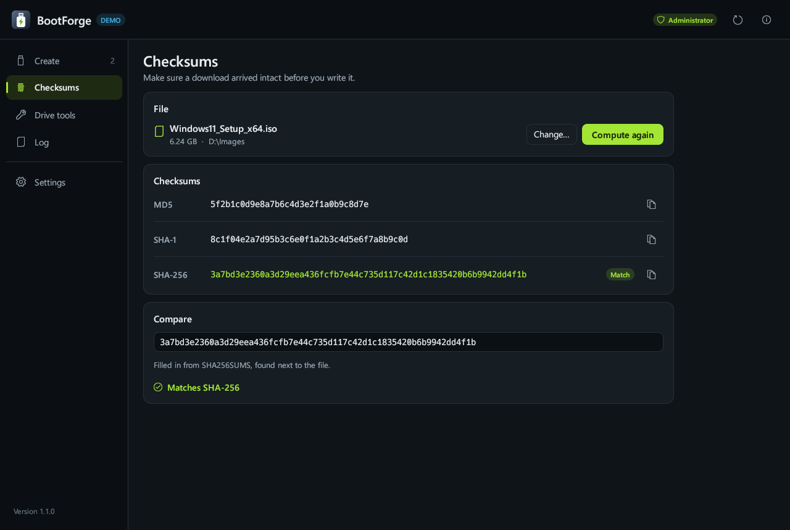</td>
<td width="50%" align="center"><b>Drive tools</b><br>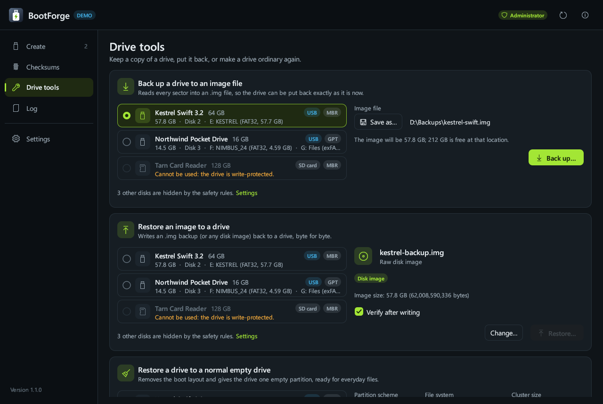</td>
</tr>
<tr>
<td width="50%" align="center"><b>Log</b><br>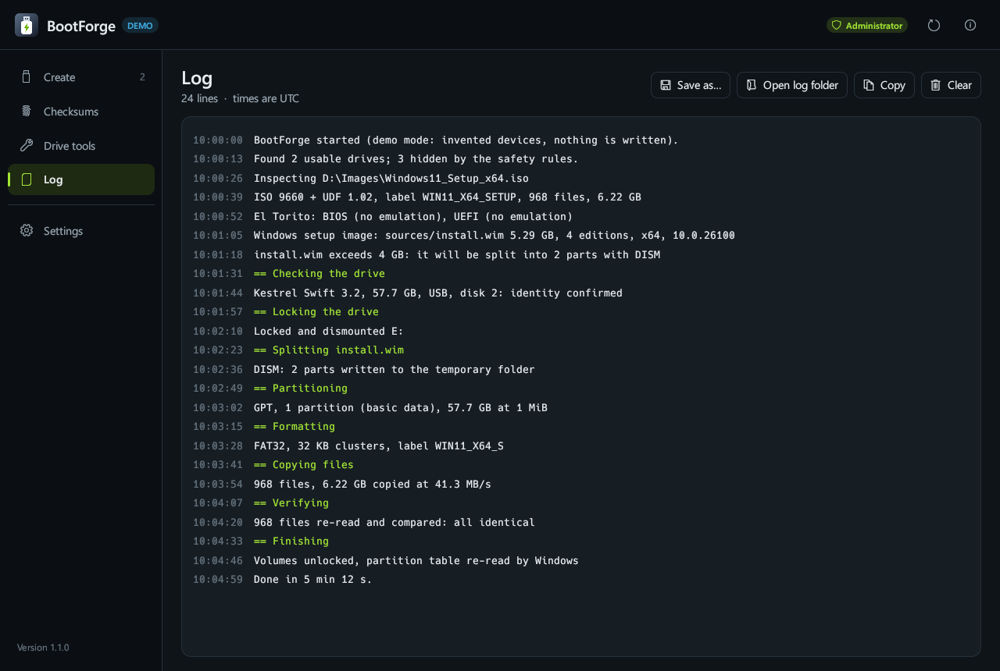</td>
<td width="50%" align="center"><b>Light theme</b><br>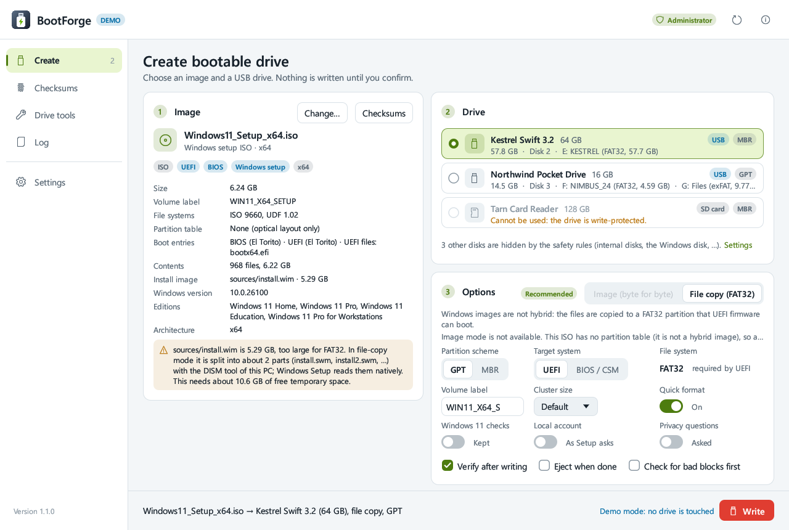</td>
</tr>
</table>

<table>
<tr>
<td width="50%" align="center"><b>Start page with recent images</b><br>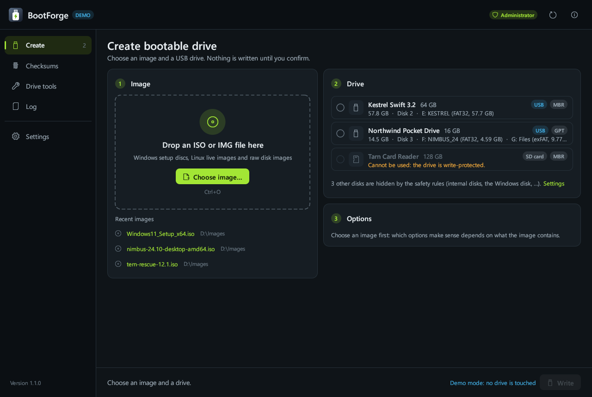</td>
<td width="50%" align="center"><b>Settings</b><br>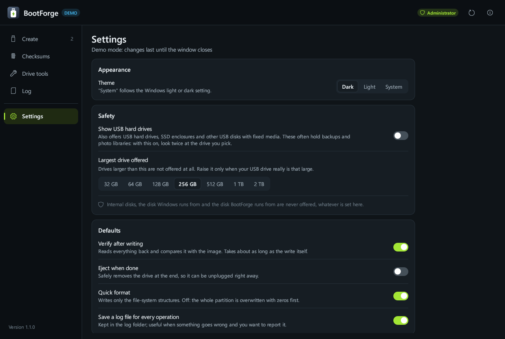</td>
</tr>
</table>

<sub>Screenshots use the built-in demo mode (<code>BootForge.exe --demo</code>), which shows invented drives and images and touches no drive.</sub>

## 📥 Download

Get it from the [**latest release**](https://github.com/zheerkhalid/bootforge/releases/latest):

| File | What it is |
|---|---|
| `BootForge-Setup.exe` | Installer with shortcuts and an uninstaller |
| `BootForge-x.y.z-portable-x64.zip` | Portable: unzip and run |
| `BootForge.exe` | The bare 4.8 MB EXE |

BootForge starts without administrator rights and asks for them when you start writing.

What changed in each version is listed in the [**changelog**](CHANGELOG.md).

## 🛡️ Safety

Writing a drive erases it, so the design makes the wrong drive hard to pick:

- **Only removable USB drives are listed.** Internal disks, the Windows disk, the disk BootForge runs from, the disk holding the image, and very large drives are hidden and refused by the engine itself, not only by the window.
- **A confirmation names the drive:** model, size, drive letters and volume labels that will be erased, with an "I understand" tick box.
- **The drive is re-checked** immediately before the first write, in case drives were swapped.
- **Problems are caught first:** a file that cannot exist on FAT32, or a drive that is too small, stops the job before the drive is touched.
- **If a write is cancelled or fails,** BootForge says the drive is half-written and points to the reset tool.

## 🏗️ Build from source

Requires Rust (stable, MSVC toolchain) on Windows.

```powershell
git clone https://github.com/zheerkhalid/bootforge
cd bootforge
cargo build --release
# -> target\release\BootForge.exe
cargo test
```

| Command | What it does |
|---|---|
| `BootForge.exe --demo` | Invented drives and images; no drive is touched |
| `BootForge.exe --inspect <file>` | Print what BootForge finds out about an image |
| `BootForge.exe --hash <file>` | Print MD5, SHA-1 and SHA-256; with `--expect <checksum>` (or a checksum file next to the file) also compare, exit code 2 on a mismatch |
| `BootForge.exe --selftest` | Build synthetic ISOs, write them to image files in both modes, and verify by parsing them back |

```
src/
  iso/         ISO 9660, Joliet, UDF, El Torito and WIM inspection
  part.rs      GPT and MBR
  fat32.rs     FAT32 formatter and writer
  engine/      the write jobs
  unattend.rs  the Windows Setup answer file
  safety.rs    which drives may be written
  device/      drive enumeration and raw access
  ui/          the egui interface
```

No third-party boot code is bundled; see [`NOTICE`](NOTICE). The icon is drawn in code at build time. The C runtime is linked statically, so the EXE runs on a clean Windows install.

## 👨‍💻 Developer

<table>
<tr>
<td align="center" width="140">
  <a href="https://zheer.dev">
    
  </a>
</td>
<td>

**Designed and developed by [Zheer Khalid](https://zheer.dev)**

🌐 Website: **[zheer.dev](https://zheer.dev)**  
🐙 GitHub: **[@zheerkhalid](https://github.com/zheerkhalid)**  
🧩 Also by Zheer: **[SnapForge](https://github.com/zheerkhalid/snapforge)**, **[ReelForge](https://github.com/zheerkhalid/reelforge)**, **[UnForge](https://github.com/zheerkhalid/unforge)**, **[KeepForge](https://github.com/zheerkhalid/keepforge)** and **[ShredForge](https://github.com/zheerkhalid/shredforge)**

If BootForge is useful to you, a ⭐ on the repo is appreciated.

</td>
</tr>
</table>

## 📄 License

MIT © 2026 [Zheer Khalid](https://zheer.dev). See [`LICENSE`](LICENSE).

<div align="center">
<sub>Built with 🦀 Rust and ❤️ by <a href="https://zheer.dev">zheer.dev</a></sub>
</div>
